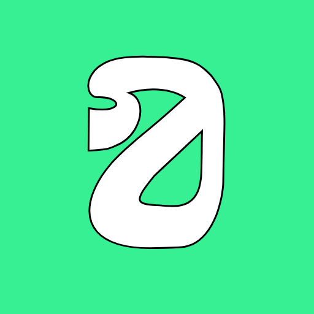
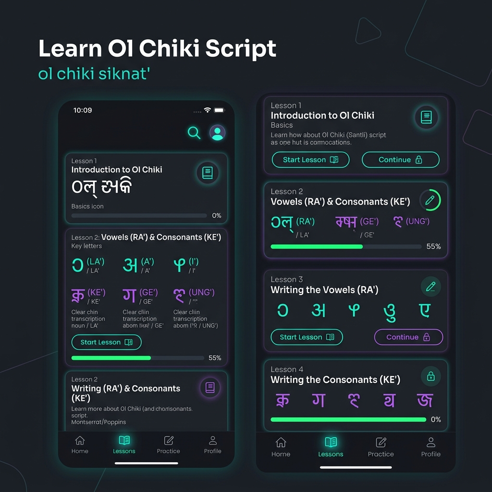
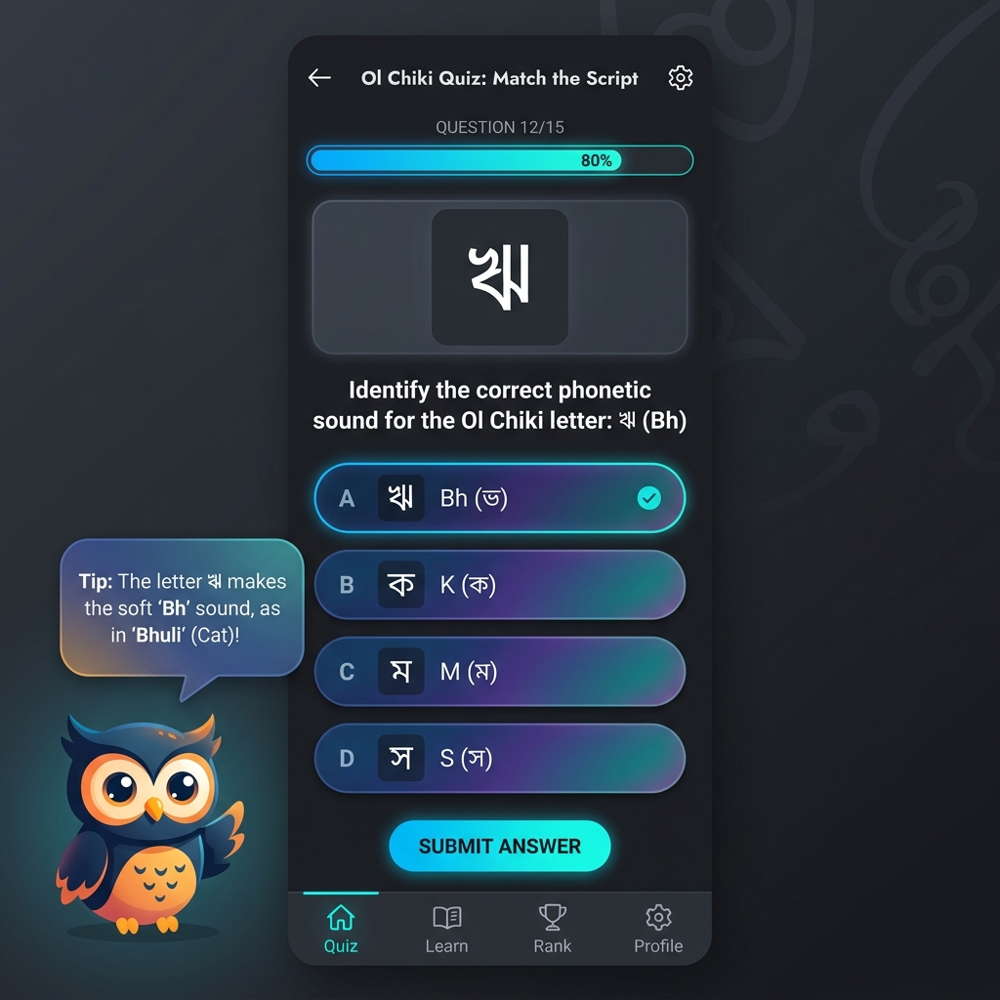
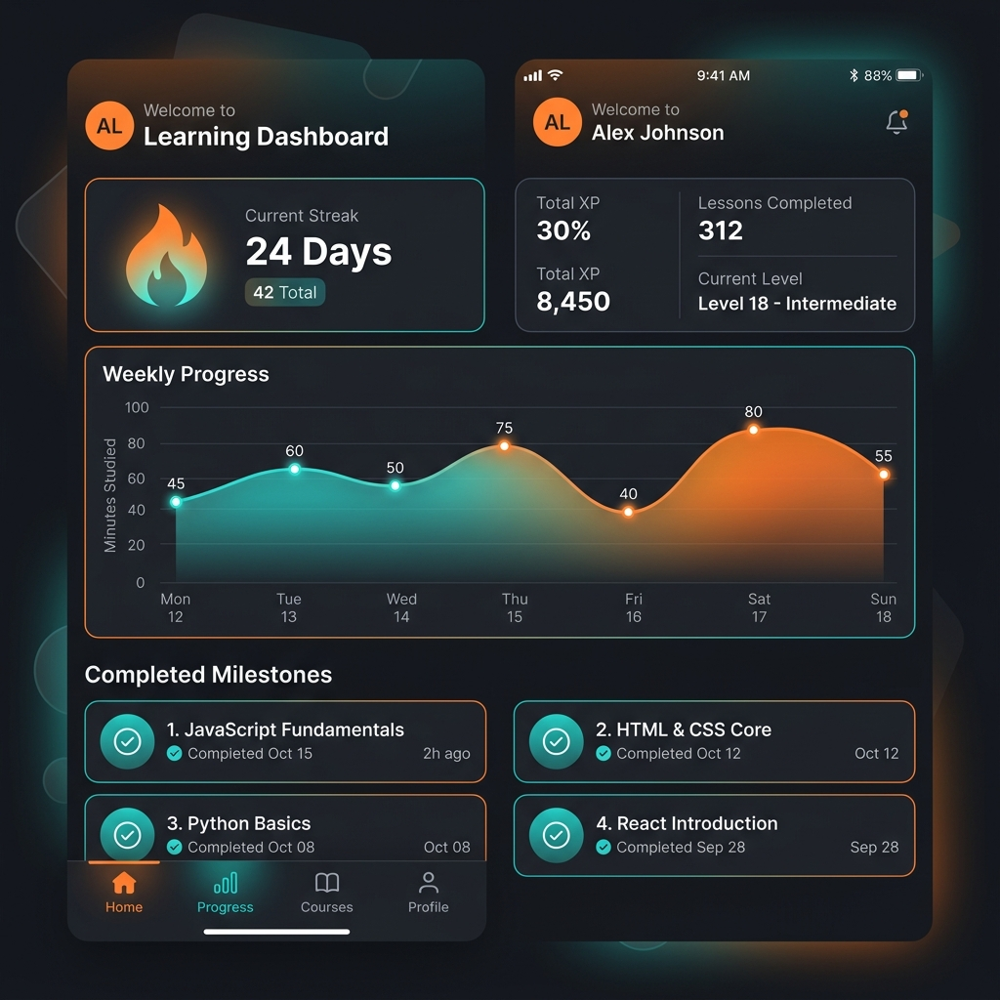
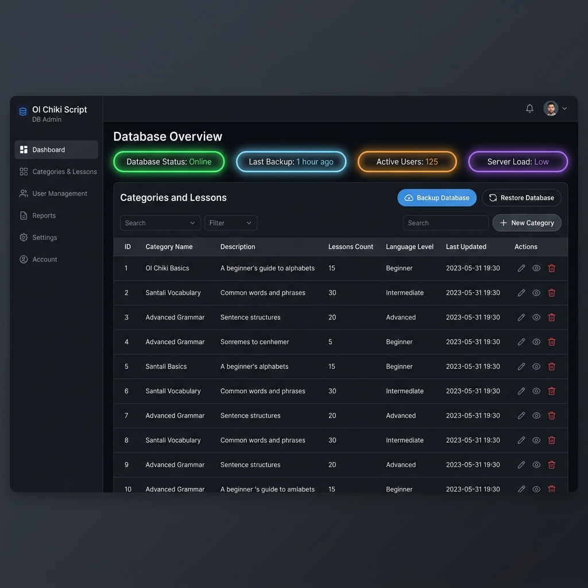
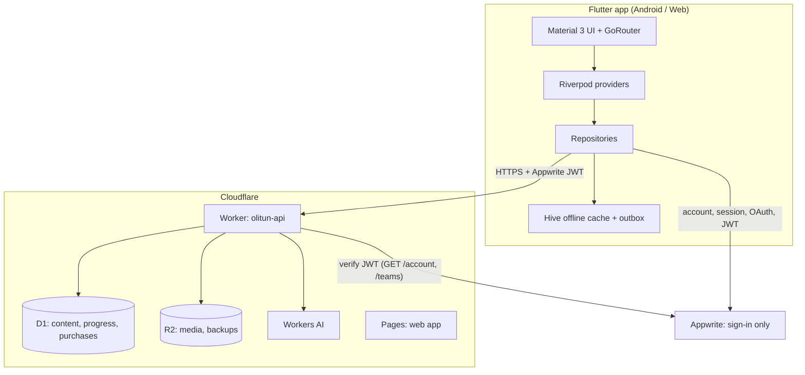

<p align="center">
  
</p>

<h1 align="center">Olitun — Learn Anything, Anywhere, Even Offline</h1>

<p align="center">
  <em>A beautifully crafted, offline-first learning platform for Ol Chiki (Santali Script) built with Flutter.</em>
</p>

<p align="center">
  <a href="https://olitun.in"><b>Official Website: olitun.in</b></a>
</p>

<p align="center">
  
  
  
  
  
  
</p>

<p align="center">
  
</p>

---

## 🌟 Why Olitun?

- **Preserving Culture:** The first premium platform dedicated to the Ol Chiki script.
- **Offline First:** Learn anywhere, even without an internet connection, thanks to Hive persistence.
- **Gamified Mastery:** Earn stars, track streaks, and advance through levels with interactive quizzes.

---

## ✨ Features

<table border="0">
  <tr>
    <td width="50%">
      <h3>📚 Lessons & Content</h3>
      <p>Progressive alphabet, numbers, words, and sentence lessons with dual-script display (Ol Chiki + Latin transliteration).</p>
      
    </td>
    <td width="50%">
      <h3>🎮 Interactive Quizzes</h3>
      <p>Multiple-choice quizzes with animated feedback, scoring, and mastery levels to keep you engaged.</p>
      
    </td>
  </tr>
  <tr>
    <td width="50%">
      <h3>📈 Progress Tracking</h3>
      <p>Streaks, stars, learning time, and cloud sync ensures your progress is never lost across devices.</p>
      
    </td>
    <td width="50%">
      <h3>🛠️ Admin CMS</h3>
      <p>Full content management dashboard for educators to update lessons, letters, and quizzes in real-time.</p>
      
    </td>
  </tr>
  <tr>
    <td width="50%">
      <h3>⌨️ Active Recall Typing</h3>
      <p>Active recall typing practice for vocabulary and sentences. Users type Ol Chiki characters using a custom on-screen keyboard, earning 5 stars per completion. Toggleable in settings; respects cultural separation (bakhed/mantras remain listening-only).</p>
    </td>
    <td width="50%">
    </td>
  </tr>
</table>

---

## 🏗️ Architecture Overview



- **Cloudflare Worker** (`cloudflare/backend`, Hono, D1 + R2) is the whole
  backend: learner content, progress, reviews, mistakes, gamification,
  payments (Razorpay), translation, voice, AI Studio, account deletion and the
  admin CMS. See [ARCHITECTURE.md](ARCHITECTURE.md#backend-cloudflare-worker).
- **Appwrite** is used only for login: account, sessions, OAuth, JWTs, and the
  Teams membership that marks admins. The app sends its Appwrite JWT to the
  Worker, which verifies it with Appwrite and never trusts a client-supplied
  user id.
- **Live updates:** admin edits append to a D1 change feed; the app polls
  `GET /api/v1/content/changes?since=<seq>` and refreshes only what changed.
- **Media** (audio, images, video, avatars, lesson HTML) lives in R2 and is
  served by the Worker; paid media only through short-lived signed URLs.

### Data and error contract

Repositories return `Either<Failure, T>` from `fpdart` at feature boundaries.
HTTP and auth errors are translated into the sealed `Failure` hierarchy
(`NetworkFailure`, `ServerFailure`, `CacheFailure`, `AuthFailure`, and
`ValidationFailure`) before reaching UI code.

Learning product analytics live in
`lib/core/analytics/analytics_service.dart`. Events such as
`lesson_started`, `lesson_completed`, `quiz_attempted`,
`quiz_question_answered`, `daily_mission_completed`, and `streak_milestone`
are sent to the Worker (`/api/v1/analytics/*`, stored in D1) when online and
queued locally when offline.

---

## 🚀 Quick Start

### Prerequisites
- Flutter SDK with Dart `^3.9.0` support
- Node.js 22 (Worker and repo scripts)
- An [Appwrite](https://appwrite.io/) project for sign-in (or the production
  one, `sgp.cloud.appwrite.io`)

### Setup
```bash
# Clone the repository
git clone https://github.com/Kh3rwa1/olitunapp.git
cd olitunapp

# Install dependencies
flutter pub get
```

### Quality checks

The test surface is intentionally part of the public repo:

- `test/core/` covers config, storage, auth helpers, API clients, motion
  tokens, logging, and error/failure types.
- `test/features/` covers auth, lessons, quiz logic, quiz screens, profile,
  home, onboarding, admin auth, categories, rhymes, and accessibility widgets.
- `test/goldens/` protects high-value learning UI surfaces.
- `test/web/` and `test/scripts/` (Node) cover the Cloudflare Pages headers
  and the build/release scripts; run them with `npm run test:backend`.
- `integration_test/` keeps end-to-end auth, legal, and quiz flows visible.

Run the same checks locally before release:

```bash
flutter analyze
flutter test
dart format .
npm run test:backend
```

### Run the app
```bash
flutter run \
  --dart-define=APP_ENV=development \
  --dart-define=APPWRITE_ENDPOINT=https://sgp.cloud.appwrite.io/v1 \
  --dart-define=APPWRITE_PROJECT_ID=<your-project-id> \
  --dart-define=CLOUDFLARE_API_URL=https://olitun.in \
  --dart-define=ADMIN_TEAM_ID=admins \
  --dart-define=SENTRY_DSN=<your-sentry-dsn>
```

`CLOUDFLARE_API_URL` selects the Worker (default
`https://olitun-api.dulalkisku0.workers.dev`; use `http://localhost:8787` for
a local Worker). Release builds must set `APP_ENV=production` (or `staging`)
and real Appwrite values; `AppwriteConfig.validate()` refuses to boot
otherwise. Admin access is membership in the Appwrite Team named by
`ADMIN_TEAM_ID` (default `admins`); see [SECURITY.md](SECURITY.md).

### Local backend (Worker)

```bash
cd cloudflare/backend
npm ci
npx wrangler d1 execute olitun-db --local --file=schema.sql   # local D1
npm run db:seed && npx wrangler d1 execute olitun-db --local --file=seed.sql
npx wrangler dev                                             # http://localhost:8787
```

`wrangler dev` runs the Worker with local D1 and R2 (Miniflare). Secrets go in
`cloudflare/backend/.dev.vars` (git-ignored): `RAZORPAY_*`, `BODHAN_API_KEYS`,
`SARVAM_API_KEY`, `MEDIA_SIGNING_SECRET`, `CRON_SECRET`, `APPWRITE_API_KEY`.
Every authenticated route verifies the caller's JWT against
`APPWRITE_ENDPOINT` (`GET /account`, plus `GET /teams` for admin routes), so
sign in to a real Appwrite project, or point `APPWRITE_ENDPOINT` in
`.dev.vars` at a mock that answers those two calls. The Worker test suite
(Worker CI) mocks Appwrite the same way and never reaches the network.

### Deploying

| Target | How |
| --- | --- |
| Worker | `deploy-worker.yml` on push to `main` (paths `cloudflare/backend/**`): runs Worker CI (`worker-ci.yml`), applies `schema.sql` to D1, uploads a new version, smoke-tests it, then promotes it. |
| Web | `deploy-web.yml` on push to `main`: `scripts/build_web.sh` then `wrangler pages deploy build/web` (Cloudflare Pages project `olitunapp`). Headers, including the CSP, come from `web/_headers`. |
| Android | `scripts/build_playstore_bundle.sh` builds the signed Play Store `.aab` locally (Worker-only defines; needs `android/key.properties`). `build-apk.yml` builds a signed APK on `v*` tags. |

See [RELEASE_CHECKLIST.md](RELEASE_CHECKLIST.md) for the full release flow.

### Managing admins

Admin access is purely Appwrite Team membership — there is no client-side
secret. The app's route guard and the Worker's `requireAdmin` both check it.

1. Open the **Appwrite Console** → **Auth** → **Teams** → select the team whose
   ID matches `ADMIN_TEAM_ID` (default `admins`).
2. **Add an admin:** click **Add member**, enter the user's email. They must
   already have an Appwrite account; once accepted they can sign in at
   `/admin/login` in the Flutter app. (Adding admins from the in-app access
   screen needs a server key, so it points to the Console.)
3. **Remove an admin:** open the team, find the member, click **Remove**. The
   Worker re-checks team membership at most every 5 minutes per token.
4. **Rotating the admin team:** create a new team, set `ADMIN_TEAM_ID` in both
   the app build and `cloudflare/backend/wrangler.json`, then delete the old
   team. The match is on the immutable team ID, never the name.

---

## 🛠️ Tech Stack

| Component | Technology |
|-----------|------------|
| **Frontend** | [Flutter](https://flutter.dev/) (Material 3) |
| **State** | [Riverpod](https://riverpod.dev/) |
| **Backend** | [Cloudflare Workers](https://workers.cloudflare.com/) + D1 + R2 ([Hono](https://hono.dev/)) |
| **Auth** | [Appwrite](https://appwrite.io/) (sign-in only) |
| **Offline DB** | [Hive](https://docs.hivedb.dev/) |
| **Navigation** | [GoRouter](https://pub.dev/packages/go_router) |
| **Charts** | [FL Chart](https://pub.dev/packages/fl_chart) |
| **Animations** | [Lottie](https://pub.dev/packages/lottie) & [Flutter Animate](https://pub.dev/packages/flutter_animate) |

---

## 📁 Project Structure

```bash
lib/
├── core/              # Theme, Auth, API, Layout, Config
├── features/          # Feature-first modules (Admin, Home, Lessons, Profile)
├── shared/            # Reusable Models, Providers, and Widgets
└── main.dart          # App Entry & Router
cloudflare/
├── backend/           # The Worker (src/index.ts + src/routes/*), schema.sql, wrangler.json
└── ai-gateway/        # Separate AI gateway Worker
web/                   # Web shell, _headers (CSP) and _redirects for Cloudflare Pages
scripts/               # Build scripts and CI gates (scripts/oneoff/: historical one-off tools)
```

---

## ✅ Quality Gates

Pull requests must pass automated gates (see `.github/workflows/flutter-ci.yml`):

- **Format + analyze** — `dart format`, `flutter analyze --fatal-infos`
- **Localization parity** — all five ARB locales share keys and placeholders
- **Hardcoded strings** — user-facing copy goes through `AppLocalizations`
- **File length** — hand-written Dart files stay ≤ 600 lines
- **Architecture boundaries** — presentation layers never import `package:appwrite`
- **Appwrite auth-only** — `lib/` may use Appwrite only for account/session/JWT/OAuth/Teams
- **Pinned actions** — every GitHub Action is pinned to a commit SHA
- **Node tests** — `npm run test:backend` (gate scripts, web headers/CSP, build scripts)
- **Worker CI** — typecheck, Worker tests, and a dry-run deploy for `cloudflare/backend`

```bash
node scripts/check_hardcoded_strings.mjs
node scripts/check_l10n_parity.mjs
node scripts/check_file_length.mjs
node scripts/check_architecture_boundaries.mjs
node scripts/check_appwrite_auth_only.mjs
node scripts/verify_pinned_actions.mjs
```

Details live in [ARCHITECTURE.md](ARCHITECTURE.md#quality-gates).

---

## 🤝 Contributing

We welcome contributions! Please see our [CONTRIBUTING.md](CONTRIBUTING.md) for guidelines.

---

## 🗺️ Roadmap

Track our progress and upcoming features on our [Public Project Board](https://github.com/users/Kh3rwa1/projects/1).

---

## 🏷️ Repository Settings

Ensure the following repository settings are configured in the GitHub repository UI settings page:

*   **Description:** `A beautifully crafted, offline-first learning platform for Ol Chiki (Santali Script) built with Flutter and Cloudflare Workers.`
*   **Homepage:** `https://olitun.in`
*   **Topics:** `flutter`, `cloudflare-workers`, `santali`, `ol-chiki`, `offline-first`, `dart`, `education`, `learning-platform`, `mobile-app`

---

## 🙏 Asset Credits

Profile avatar animations are free Lottie files by Google Inc. via
[IconScout](https://iconscout.com) (free-animal-and-nature-animation packs
`344421` and `344422`, free license with attribution) and free community
animations via [LottieFiles](https://lottiefiles.com) (see source links in
[`tool/iconscout-avatar-import.tsv`](tool/iconscout-avatar-import.tsv)).

### Managing avatars without a release

The picker reads the Worker's avatar catalogue (`GET /api/v1/avatars`,
every object under `avatars/` in R2) first: upload a valid `.json` Lottie to
the `avatars` bucket from the admin media screen and it appears as a choice
on next launch — no app update needed. Deleting a file removes that choice (stored picks migrate
to the default). The bundled `assets/animations/avatars/` set is the
offline fallback and is never deleted.

---

## 📄 License

This project is proprietary - see the [LICENSE](LICENSE) file for details.
See also the [Privacy Policy](PRIVACY.md), [Terms Of Use](TERMS.md), and
[Release Checklist](RELEASE_CHECKLIST.md).

---

<p align="center">
  <b>Johar! ᱡᱚᱦᱟᱨ!</b> 🙏
</p>
